<a href="https://github.com/pasindu-hansaka"><picture><source media="(prefers-color-scheme: dark)" srcset="https://raw.githubusercontent.com/pasindu-hansaka/pasindu-hansaka/main/assets/letterhead-dark.svg" /></picture></a>

<a href="https://github.com/pasindu-hansaka">
<picture>
  <source media="(prefers-color-scheme: light)" srcset="https://readme-typing-svg.demolab.com?font=Cormorant+Garamond&weight=600&size=30&pause=1200&center=true&vCenter=true&width=640&height=50&lines=Python+%C2%B7+AI+agents+%C2%B7+Control+systems;Machine+learning+algorithms;Building+in+public&color=59636E" />
  
</picture>
</a>

<em>Engineer building AI agents, control systems and the software in between, and sharing the work in public.</em>

  <a href="https://pasindu-hansaka.github.io"><picture><source media="(prefers-color-scheme: dark)" srcset="https://img.shields.io/badge/Portfolio-visit-9198A1?style=for-the-badge&logo=githubpages&logoColor=1F2328&labelColor=E6EDF3" /></picture></a>
  <a href="https://github.com/pasindu-hansaka"><picture><source media="(prefers-color-scheme: dark)" srcset="https://img.shields.io/badge/GitHub-follow-9198A1?style=for-the-badge&logo=github&logoColor=1F2328&labelColor=E6EDF3" /></picture></a>

## On the workbench

<picture><source media="(prefers-color-scheme: dark)" srcset="https://raw.githubusercontent.com/pasindu-hansaka/pasindu-hansaka/main/assets/workbench-dark.svg?v=2" /></picture>

<picture><source media="(prefers-color-scheme: dark)" srcset="https://raw.githubusercontent.com/pasindu-hansaka/pasindu-hansaka/main/assets/divider-dark.svg" /></picture>

## Tech stack

<picture><source media="(prefers-color-scheme: dark)" srcset="https://raw.githubusercontent.com/pasindu-hansaka/pasindu-hansaka/main/assets/toolbox-dark.svg" /></picture>

<picture><source media="(prefers-color-scheme: dark)" srcset="https://raw.githubusercontent.com/pasindu-hansaka/pasindu-hansaka/main/assets/divider-dark.svg" /></picture>

## Featured projects

<table width="100%">
<tr>
<td width="50%" align="center">
<a href="https://github.com/pasindu-hansaka/PSB-Chatbot"><picture><source media="(prefers-color-scheme: dark)" srcset="https://raw.githubusercontent.com/pasindu-hansaka/pasindu-hansaka/main/assets/project-ai-dark.svg" /></picture></a>

</td>
<td width="50%" align="center">
<a href="https://github.com/pasindu-hansaka/file-organizer"><picture><source media="(prefers-color-scheme: dark)" srcset="https://raw.githubusercontent.com/pasindu-hansaka/pasindu-hansaka/main/assets/project-cli-dark.svg" /></picture></a>

</td>
</tr>
<tr>
<td width="50%" align="center">
<a href="https://github.com/pasindu-hansaka/self-balancing-unicycle"><picture><source media="(prefers-color-scheme: dark)" srcset="https://raw.githubusercontent.com/pasindu-hansaka/pasindu-hansaka/main/assets/project-sim-dark.svg" /></picture></a>

</td>
<td width="50%" align="center">
<a href="https://github.com/pasindu-hansaka/pasindu-hansaka.github.io"><picture><source media="(prefers-color-scheme: dark)" srcset="https://raw.githubusercontent.com/pasindu-hansaka/pasindu-hansaka/main/assets/project-web-dark.svg" /></picture></a>

</td>
</tr>
</table>

<picture><source media="(prefers-color-scheme: dark)" srcset="https://raw.githubusercontent.com/pasindu-hansaka/pasindu-hansaka/main/assets/divider-dark.svg" /></picture>

## GitHub activity

<picture><source media="(prefers-color-scheme: dark)" srcset="https://raw.githubusercontent.com/pasindu-hansaka/pasindu-hansaka/output/activity-dark.svg" /></picture>

<picture>
  <source media="(prefers-color-scheme: dark)" srcset="https://raw.githubusercontent.com/pasindu-hansaka/pasindu-hansaka/output/github-snake-dark.svg" />
  
</picture>

<picture><source media="(prefers-color-scheme: dark)" srcset="https://raw.githubusercontent.com/pasindu-hansaka/pasindu-hansaka/main/assets/divider-dark.svg" /></picture>

## Get in touch

  <a href="https://pasindu-hansaka.github.io"><picture><source media="(prefers-color-scheme: dark)" srcset="https://img.shields.io/badge/Portfolio-visit-9198A1?style=for-the-badge&logo=githubpages&logoColor=1F2328&labelColor=E6EDF3" /></picture></a>
  <a href="https://github.com/pasindu-hansaka"><picture><source media="(prefers-color-scheme: dark)" srcset="https://img.shields.io/badge/GitHub-follow-9198A1?style=for-the-badge&logo=github&logoColor=1F2328&labelColor=E6EDF3" /></picture></a>
  <a href="https://github.com/pasindu-hansaka/pasindu-hansaka/issues/new"><picture><source media="(prefers-color-scheme: dark)" srcset="https://img.shields.io/badge/Open-an%20issue-9198A1?style=for-the-badge&logo=github&logoColor=1F2328&labelColor=E6EDF3" /></picture></a>

