<a href="https://github.com/pasindu-hansaka">
<picture>
  <source media="(prefers-color-scheme: light)" srcset="https://readme-typing-svg.demolab.com?font=Fira+Code&weight=600&size=28&pause=1200&center=true&vCenter=true&width=640&height=50&lines=Hi%2C+I'm+Pasindu+Hansaka;Python+%7C+AI+assistants+%7C+Control+systems;Building+in+public&color=0891B2" />
  
</picture>
</a>

I build Python tools, AI assistants and control-system simulations, and I share the work in public.

  
  

## About me

## Toolbox

## Featured projects

<table width="100%">
<tr>
<td width="50%" align="center">

</td>
<td width="50%" align="center">

</td>
</tr>
<tr>
<td width="50%" align="center">

</td>
<td width="50%" align="center">

</td>
</tr>
</table>

## Contribution activity

<picture>
  <source media="(prefers-color-scheme: dark)" srcset="https://raw.githubusercontent.com/pasindu-hansaka/pasindu-hansaka/output/github-snake-dark.svg" />
  
</picture>

## Let's build together

  
  
  

