<a href="https://github.com/pasindu-hansaka">
<picture>
  <source media="(prefers-color-scheme: light)" srcset="https://readme-typing-svg.demolab.com?font=Cormorant+Garamond&weight=600&size=30&pause=1200&center=true&vCenter=true&width=640&height=50&lines=Python+%C2%B7+AI+agents+%C2%B7+Control+systems;Machine+learning+algorithms;Building+in+public&color=6B5232" />
  
</picture>
</a>

<em>I build Python tools, AI assistants and control-system simulations, and I share the work in public.</em>

  
  

## About me

## Toolbox

## Featured projects

<table width="100%">
<tr>
<td width="50%" align="center">

</td>
<td width="50%" align="center">

</td>
</tr>
<tr>
<td width="50%" align="center">

</td>
<td width="50%" align="center">

</td>
</tr>
</table>

## Contribution activity

<picture>
  <source media="(prefers-color-scheme: dark)" srcset="https://raw.githubusercontent.com/pasindu-hansaka/pasindu-hansaka/output/github-snake-dark.svg" />
  
</picture>

  
  

